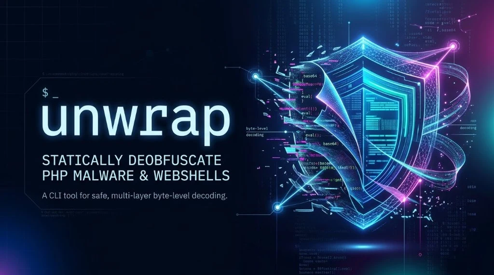

# unwrap — Desofuscador Estático de Malware y Webshells PHP (`v2.0.0`)



Una CLI moderna e independiente en Bash + Python 3 para **desofuscar estáticamente malware y webshells PHP multicapa** (`eval`, `gzinflate`, `base64_decode`, `str_rot13`, `gzuncompress`, `gzdecode`, `hex2bin`, `strrev`, `urldecode`) — reemplazando el legado Python 2 `unwrap` (2011) con decodificación segura en bytes y salidas `table` / `json` / `csv`.

## Modernización Histórica

Inspirado en el script original **`unwrap`** en Python 2 (**© 2011 — HostGator.com, LLC**), diseñado para analizar código PHP ofuscado sin ejecutarlo.

En `v2.0.0`, fue reescrito en **Bash + Python 3.6+ (stdlib)** eliminando APIs obsoletas de Python 2, corrigiendo el bug de `shlex` con bytes binarios de `gzinflate` y añadiendo `gzdecode`, `hex2bin`, `strrev`, escaneo recursivo (`-r`) e indicadores de webshell.

## Ejemplo de Salida Real

```text
$ ./unwrap.sh /tmp/unwrap-e2e/shell.php --no-color
=== unwrap.sh v2.0.0 | Static PHP Deobfuscator ===
  File:       /tmp/unwrap-e2e/shell.php
  Layers:     4 (str_rot13 -> base64_decode -> gzinflate -> eval)
  Indicators: $_POST, system
  Decoded:
    system($_POST['cmd']);
----------------------------------------------------------------------------
```

## Licencia

Apache-2.0 — ver [LICENSE](LICENSE).
