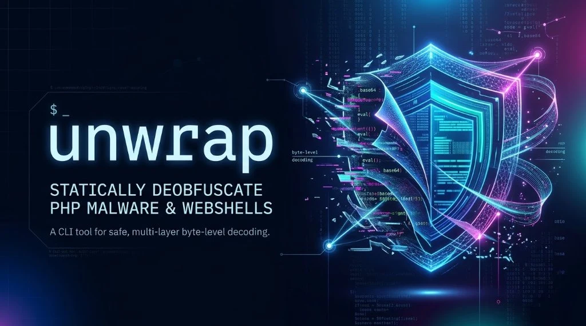

# unwrap — Desofuscador Estático de Malware e Webshells PHP (`v2.0.0`)



Uma CLI moderna e independente em Bash + Python 3 para **desofuscar estaticamente malware e webshells PHP multicamadas** (`eval`, `gzinflate`, `base64_decode`, `str_rot13`, `gzuncompress`, `gzdecode`, `hex2bin`, `strrev`, `urldecode`) — substituindo o legado em Python 2 `unwrap` (2011) com decodificação segura em bytes, detecção de indicadores e saídas `table` / `json` / `csv`.

## Modernização Histórica

Inspirado no script original **`unwrap`** em Python 2 (**© 2011 — HostGator.com, LLC**), criado para decodificar estaticamente scripts PHP ofuscados sem executá-los.

Na versão `v2.0.0`, a ferramenta foi reescrita em **Bash + Python 3.6+ (stdlib)**:
- **Fim do Python 2 Legado**: Substitui `string.letters`, `.encode('rot13')`, `.decode('base64')` e `optparse` por `codecs`, `base64`, `zlib` e `argparse`.
- **Decodificação Recursiva Segura em Bytes**: Corrige a quebra do `shlex.shlex` e `split(';')` em payloads binários de `gzinflate(...)`.
- **Novos Transformadores e Forense**: Adiciona `gzdecode`, `strrev`, `hex2bin`, `urldecode`, escapes `\xHH`, varredura recursiva (`-r`) e detecção de indicadores (`system`, `shell_exec`, `$_POST`).

## Exemplo de Saída Real

```text
$ ./unwrap.sh /tmp/unwrap-e2e/shell.php --no-color
=== unwrap.sh v2.0.0 | Static PHP Deobfuscator ===
  File:       /tmp/unwrap-e2e/shell.php
  Layers:     4 (str_rot13 -> base64_decode -> gzinflate -> eval)
  Indicators: $_POST, system
  Decoded:
    system($_POST['cmd']);
----------------------------------------------------------------------------
```

## Licença

Apache-2.0 — veja [LICENSE](LICENSE).
